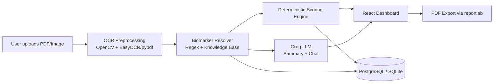

<div align="center">

# 🩺 MediScan AI

### Turning confusing lab reports into clear, personalized health insights

[](https://medi-scan-ai-weld.vercel.app/)


[**🔗 Live Demo**](https://medi-scan-ai-weld.vercel.app/) · [**📂 Repo**](https://github.com/MunaafN/MediScan-AI) · [Features](#-key-features) · [Setup](#-setup--startup-instructions)

</div>

---

## 📖 About

Most people receive their blood test results as a dense PDF full of acronyms, reference ranges, and no context — and are left Googling terms like "ALT" or "eGFR" alone. **MediScan AI** is an educational lab-report analyzer that turns raw, unstructured clinical panels into a clear, visual, and explainable health summary.

Upload a PDF or photo of a lab report, and MediScan AI will:

1. **Read it** — OCR + image preprocessing extracts the raw text, even from scanned or photographed reports
2. **Understand it** — a biomarker resolver maps messy text to a canonical set of ~40+ standardized markers (metabolic, lipid, hepatic, renal, inflammatory)
3. **Score it** — a deterministic scoring engine computes a 0–100 Health Score and risk category
4. **Explain it** — an LLM (via Groq) generates a plain-language summary and answers follow-up questions through a guardrailed chat assistant
5. **Track it** — a longitudinal dashboard shows how your biomarkers trend across multiple reports over time

> ⚠️ **Disclaimer:** MediScan AI is a student/educational project built to demonstrate a full-stack AI pipeline. It is **not a medical device** and does not provide medical advice, diagnosis, or treatment. Always consult a licensed healthcare professional about your lab results.

---

## 🎬 Demo

<p align="center">
  

</p>

---

## 🚀 Key Features

| Feature | Description |
|---|---|
| **Advanced OCR Pipeline** | Preprocesses scans with OpenCV (CLAHE contrast, bilateral filtering, sharpening) and extracts text via `pypdf` / `EasyOCR` |
| **Standardized Biomarker Resolver** | Regex-based parsing maps OCR output to a canonical medical knowledge base of reference ranges |
| **Deterministic Risk Scoring** | Evaluates metabolic, lipid, hepatic, renal, and inflammatory markers into a 0–100 Health Score and risk category (Very Low → Critical) |
| **Groq Cloud AI Integration** | Uses `openai/gpt-oss-120b` for AI summaries & chat, and `qwen/qwen3.6-27b` for multimodal OCR |
| **Longitudinal Trends Dashboard** | Interactive `recharts` line charts showing biomarker progression over time |
| **Educational Chat Assistant** | Guardrailed AI chat for explaining tests, terminology, and general nutrition context |
| **Branded PDF Export** | Generates printable, styled report summaries via `reportlab` |

---

## 🏗️ Architecture



**Flow:** Frontend (React/Vite) → FastAPI backend → OCR & parsing pipeline → scoring engine + Groq LLM → results persisted to Postgres/Supabase (or SQLite fallback) → rendered back to the dashboard.

---

## 🛠️ Tech Stack

- **Frontend**: React 18, TypeScript, Vite, Tailwind CSS, Recharts, Lucide Icons, Framer Motion
- **Backend**: FastAPI, Python 3.12, Uvicorn, SQLAlchemy
- **Database**: PostgreSQL (Supabase) / SQLite fallback
- **OCR & AI**: OpenCV, PyPDF, EasyOCR, Groq Cloud SDK

---

## 📁 Project Structure

```
MediScan-AI/
├── backend/          # FastAPI app, OCR pipeline, scoring engine, Groq integration
├── frontend/         # React + Vite dashboard, chat UI, charts
├── sample_reports/   # Example lab reports for testing the pipeline
└── README.md
```

---

## 💻 Setup & Startup Instructions

### Prerequisites

- Python 3.12+
- Node.js 18+
- Groq API Key ([Groq Console](https://console.groq.com))
- Supabase account (optional — falls back to SQLite)

### Backend Setup (FastAPI)

```bash
cd backend
python -m venv venv

# Windows
.\venv\Scripts\activate
# macOS/Linux
source venv/bin/activate

pip install -r requirements.txt
```

Configure `.env` (copy from `.env.example`):

```env
GROQ_API_KEY="your_groq_api_key"
DATABASE_URL="sqlite:///./mediscan.db"   # or Supabase URI
PRIMARY_MODEL="openai/gpt-oss-120b"
FAST_MODEL="openai/gpt-oss-120b"
VISION_MODEL="qwen/qwen3.6-27b"
```

Run the server:

```bash
python -m uvicorn app.main:app --host 127.0.0.1 --port 8000 --reload
```

API docs available at `http://127.0.0.1:8000/api/v1/docs`.

### Frontend Setup (Vite + React)

```bash
cd frontend
npm install
```

Configure `.env`:

```env
VITE_API_BASE_URL="http://127.0.0.1:8000/api/v1"
VITE_SUPABASE_URL="https://your-supabase-url.supabase.co"
VITE_SUPABASE_ANON_KEY="your-anon-key"
```

```bash
npm run dev
```

App runs at `http://localhost:3000`.

---

<details>
<summary><h2 style="display:inline">🔒 Database Row Level Security (RLS)</h2></summary>

To secure user records on Supabase, RLS must be enabled with explicit casting for string-based user IDs:

```sql
-- 1. Enable RLS
ALTER TABLE public.users ENABLE ROW LEVEL SECURITY;
ALTER TABLE public.profiles ENABLE ROW LEVEL SECURITY;
ALTER TABLE public.reports ENABLE ROW LEVEL SECURITY;
ALTER TABLE public.chat_history ENABLE ROW LEVEL SECURITY;
ALTER TABLE public.biomarkers ENABLE ROW LEVEL SECURITY;

-- 2. Add Policies
CREATE POLICY "Users can only read and write their own record" ON public.users FOR ALL USING (auth.uid()::text = id);
CREATE POLICY "Users can only read and write their own profile" ON public.profiles FOR ALL USING (auth.uid()::text = user_id);
CREATE POLICY "Users can only read and write their own reports" ON public.reports FOR ALL USING (auth.uid()::text = user_id);
CREATE POLICY "Users can only read and write their own chat history" ON public.chat_history FOR ALL USING (auth.uid()::text = user_id);
CREATE POLICY "Users can only read and write biomarkers of their own reports" ON public.biomarkers FOR ALL USING (
  EXISTS (
    SELECT 1 FROM public.reports
    WHERE reports.id = biomarkers.report_id
    AND reports.user_id = auth.uid()::text
  )
);
```

</details>

---

## 🎓 Project Context

Built as a [course/capstone] project to explore an end-to-end AI product pipeline: document ingestion (OCR), rules-based domain logic (biomarker scoring), and generative AI (LLM summarization), tied together in a production-style full-stack app deployed to Vercel + a hosted API.

**Key learning outcomes:**
- Designing a deterministic scoring system alongside a probabilistic LLM layer, and keeping the two clearly separated
- Building an OCR preprocessing pipeline robust to noisy, real-world scanned documents
- Implementing row-level security for multi-tenant health data on Supabase/Postgres
- Shipping a full-stack app (FastAPI + React) with a live deployment

---

## 🗺️ Roadmap

- [ ] Support additional lab report formats (e.g. international units)
- [ ] Mobile-friendly capture flow
- [ ] Export trends as CSV
- [ ] Expand biomarker knowledge base

---

## 📄 License

This project is licensed under the MIT License — see [LICENSE](LICENSE) for details.

## 👤 Author / Contributors

**MunaafN** - https://github.com/MunaafN <br>
**Rafe Ali Khan** - https://github.com/RafeAliKhan <br>
**Nabeel Islam** - https://github.com/nabeel-cse 
